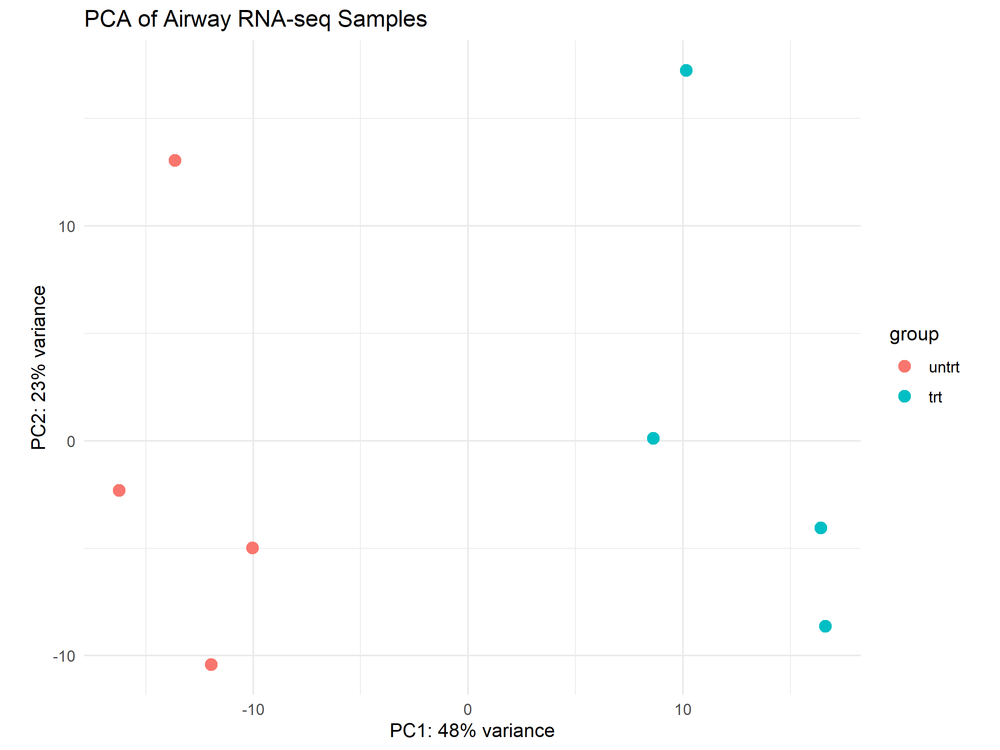
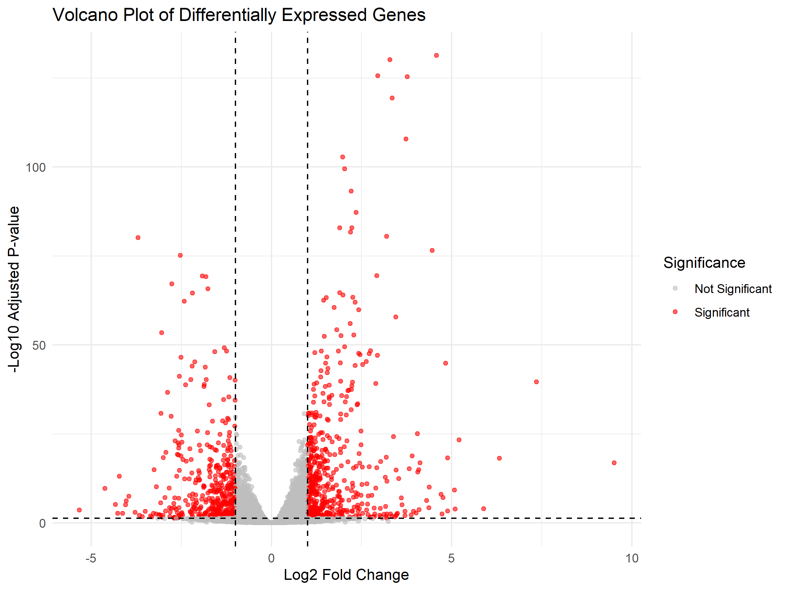
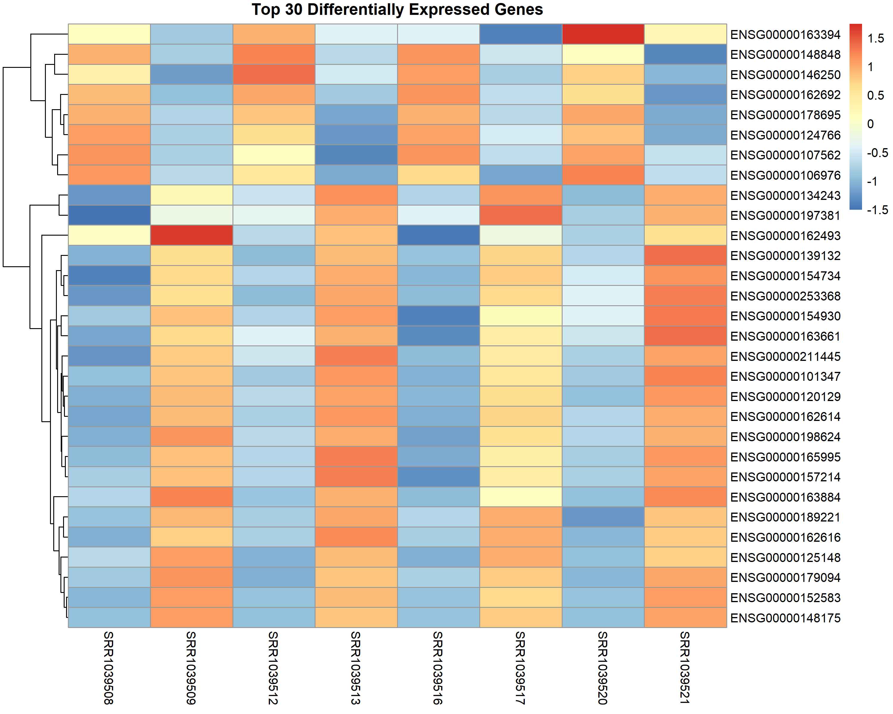

# Differential Gene Expression Analysis of RNA-seq Data Using DESeq2

## Project Overview

This project involves the analysis of publicly available RNA-sequencing data to identify differentially expressed genes following dexamethasone treatment in human airway smooth muscle cells.

The analysis was performed using **DESeq2 in R**, followed by Gene Ontology (GO) and KEGG pathway enrichment analyses to investigate the biological processes and pathways associated with the observed gene expression changes.

## Objectives

- Perform differential gene expression analysis of RNA-seq count data.
- Identify significantly upregulated and downregulated genes.
- Visualize gene expression patterns using PCA, volcano plots and heatmaps.
- Perform GO enrichment analysis to identify overrepresented biological processes.
- Perform KEGG pathway enrichment to identify associated biological pathways.
- Interpret the biological significance of the identified gene sets.

## Dataset

The project uses the publicly available **airway** dataset from Bioconductor.

| Feature | Description |
|---|---|
| Organism | *Homo sapiens* |
| Dataset | airway |
| Total samples | 8 |
| Untreated samples | 4 |
| Dexamethasone-treated samples | 4 |
| Experimental material | Airway smooth muscle cells |
| Initial genes | 63,677 |
| Experimental conditions | Treated and untreated |

The dataset contains samples from four cell lines, with each cell line represented under both treatment conditions.

The experimental design used was:

`~ cell + dex`

This design accounts for cell-line differences while estimating the treatment-associated expression changes.

**Data source:** [Bioconductor – airway](https://bioconductor.org/packages/airway/)

## Tools and Technologies

- **R** – Statistical computing and data analysis
- **Bioconductor** – Bioinformatics package ecosystem
- **DESeq2** – Differential gene expression analysis
- **airway** – RNA-seq dataset
- **clusterProfiler** – Functional enrichment analysis
- **org.Hs.eg.db** – Human gene annotation
- **enrichplot** – Enrichment visualization
- **ggplot2** – Data visualization
- **AnnotationDbi** – Gene annotation and ID mapping


## Reproducibility

The complete analysis workflow is provided in `DESeq2_Analysis.R`.

To reproduce the analysis:

1. Install R and RStudio.
2. Download or clone this repository.
3. Open `DESeq2_Analysis.R` in RStudio.
4. Set the working directory to the repository folder.
5. Run the script to perform differential expression analysis, functional enrichment and visualization.

Required CRAN and Bioconductor packages are installed through the script if they are not already available.


## Methodology

### 1. Data Preparation

- Loaded the airway dataset from Bioconductor.
- Examined sample metadata and experimental conditions.
- Constructed a DESeqDataSet object.
- Applied low-count filtering to remove genes with very low expression.

### 2. Differential Gene Expression Analysis

DESeq2 was used to identify genes showing significant expression differences between dexamethasone-treated and untreated samples.

The analysis included:

- Size-factor normalization using the median-of-ratios method.
- Dispersion estimation.
- Negative binomial model fitting.
- Wald statistical testing.
- Benjamini–Hochberg adjustment for multiple testing.

Genes were classified as significantly differentially expressed using the following thresholds:

- Adjusted p-value (padj) < 0.05
- Absolute log2 fold change > 1

### 3. Data Visualization

The following visualizations were generated:

- **PCA Plot:** To examine sample-level expression patterns and variation.
- **Volcano Plot:** To visualize the relationship between fold change and statistical significance.
- **Heatmap:** To examine expression patterns of the top differentially expressed genes.

### 4. GO Enrichment Analysis

Gene Ontology enrichment analysis was performed using the `clusterProfiler` package.

The analysis focused on the **Biological Process (BP)** category and was performed separately for:

- All significant genes.
- Upregulated genes.
- Downregulated genes.

Ensembl gene IDs were converted into Entrez Gene IDs using `org.Hs.eg.db`.

### 5. KEGG Pathway Enrichment

KEGG pathway enrichment analysis was performed using `enrichKEGG()` from the `clusterProfiler` package.

The analysis was conducted separately for all significant, upregulated and downregulated genes.

A background gene universe derived from genes retained in the DESeq2 analysis was supplied for enrichment testing.

## Results

### 1. Differential Expression Analysis

Using the selected significance thresholds, the analysis identified:

| Result | Number of genes |
|---|---:|
| Total significant genes | 1,011 |
| Upregulated genes | 528 |
| Downregulated genes | 483 |

A total of 933 significant genes were successfully mapped to Entrez Gene IDs for functional enrichment analysis.

### 2. GO Enrichment Results

The GO Biological Process analysis identified enriched terms associated with:

- Extracellular matrix organization.
- Muscle system processes.
- Regulation of actin filament-based processes.
- Angiogenesis.
- Cell migration.
- Axon guidance.
- Cell projection morphogenesis.

**Upregulated genes** showed prominent enrichment in extracellular matrix organization, muscle-related processes and actin filament regulation.

**Downregulated genes** showed enrichment in axon guidance, cell projection morphogenesis and cell migration-related processes.

### 3. KEGG Enrichment Results

The KEGG analysis identified the following numbers of significantly enriched pathways:

| Gene set | Enriched pathways |
|---|---:|
| All significant genes | 12 |
| Upregulated genes | 3 |
| Downregulated genes | 20 |

Some notable enriched pathways included:

- Cytoskeleton in muscle cells.
- Tyrosine metabolism.
- Drug metabolism – cytochrome P450.
- Cytokine-cytokine receptor interaction.
- Axon guidance.
- Inflammatory mediator regulation of TRP channels.
- Regulation of lipolysis in adipocytes.
- Calcium signaling pathway.

The enrichment results indicate that dexamethasone-associated expression changes involve multiple biological processes and pathways related to cellular structure, signalling, metabolism and regulation.

## Key Visualizations

The project includes the following visual outputs:

| Analysis | Visualization |
|---|---|
| Sample-level analysis | PCA plot |
| Differential expression | Volcano plot |
| Gene expression patterns | Heatmap |
| Functional enrichment | GO dot plots |
| Pathway enrichment | KEGG dot plots |


### Visual Outputs

#### 1. PCA Plot


#### 2. Volcano Plot


#### 3. Heatmap



The GO and KEGG analyses include separate visualizations for all significant, upregulated and downregulated genes.

## Repository Structure

```text
DESeq2-RNAseq-Differential-Expression-Analysis/
│
├── README.md
├── DESeq2_Analysis.R
│
├── Results/
│   ├── DESeq2_all_results.csv
│   ├── DESeq2_significant_genes.csv
│   ├── Top_10_Annotated_Genes.csv
│   ├── GO_All_DEGs.csv
│   ├── GO_Upregulated.csv
│   ├── GO_Downregulated.csv
│   ├── KEGG_All_DEGs.csv
│   ├── KEGG_Upregulated.csv
│   └── KEGG_Downregulated.csv
│
└── Figures/
    ├── PCA_Plot.png
    ├── Volcano_Plot.png
    ├── Heatmap.png
    ├── GO_All_DEGs.png
    ├── GO_Upregulated.png
    ├── GO_Downregulated.png
    ├── KEGG_All_DEGs.png
    ├── KEGG_Upregulated.png
    └── KEGG_Downregulated.png
```

## Limitations

- The analysis was performed using a relatively small dataset consisting of eight samples.
- The findings are based on a single publicly available experimental dataset.
- Functional enrichment results indicate associations with biological processes and pathways but do not independently establish causality.
- Some genes could not be mapped to Entrez Gene IDs and were therefore excluded from enrichment analysis.

## Conclusion

This project demonstrates an RNA-seq differential expression analysis workflow using DESeq2, followed by functional enrichment analysis using GO and KEGG databases.

The analysis identified 1,011 significantly differentially expressed genes, including 528 upregulated and 483 downregulated
